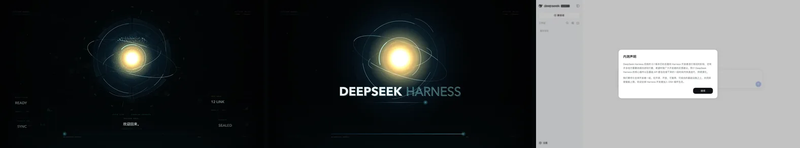

# dsh-guardian-boot

给 **DeepSeek Harness** 的启动界面：15.8 秒唤醒序列，青蓝全息层 + 暖金核心 + 六节点编排图，三句语音 + 中文字幕 + 实时频谱。



## 安装

```bash
# 先停掉正在运行的 dsh web
dsh plugin --profile web add dsh-guardian-boot
dsh web
```

也可以从 GitHub 装（推荐钉版本）：

```bash
dsh plugin --profile web add github:darkknight110/dsh-guardian-boot#v1.0.0
```

或从 Releases 下载 `.tgz` 后 `dsh plugin --profile web add ./dsh-guardian-boot-1.0.0.tgz`。

装完重启 `dsh web`，刷新页面即可看到启动序列。卸载：

```bash
dsh plugin --profile web remove dsh-guardian-boot
```

## 它会做什么

1. 宿主侧注册 `/guardian` 前缀路由，只服务 `lib/public/` 下的白名单文件。
2. `tapIndex` 在首页 `</head>` 前插入关键 CSS，`<body>` 后插入一层全屏 `#guardian-root`。
3. 频次门通过（`sessionStorage`，一个标签页会话一次）之后，才给 iframe 赋 `src`——没过门不会有任何下载。

启动序列播完或跳过时，遮罩整层移除、滚动锁解除、焦点交还输入框，并派发 `dsh-startup:done`。

## 操作

| 操作 | 行为 |
| --- | --- |
| 打开页面 | 自动播放；能自动出声就出声，被拦则画面先走 |
| 点击画面（首次） | 解锁声音并从头对齐播放 |
| `Esc` | 跳过，立即把界面交还宿主 |
| 13.82s 后 `Enter` / 点击 | 进入会话 |
| `Space` | 重播 |
| `M` | 开关声音 |
| `R` | 录制带声音的 WebM |

## 工程说明

| 决定 | 原因 |
| --- | --- |
| iframe 隔离 | 动画脚本假设自己是整个 document；隔离后零污染宿主，播完整层 `remove()` |
| `data-src` 延迟赋值 | 只做 `display:none` 的话，浏览器仍会下载并启动动画 |
| 后备存储按 `min(dpr,2)` 放大 | 逻辑坐标仍是 1920×1080，Retina 上画 3840×2160 |
| 32s 兜底卸载 | iframe 挂了或用户不操作，主界面不会被永久遮住 |
| 终幕 6s 后停 RAF | 不让待命动画常驻烧 GPU |

## 兼容性

- 在 **DSH 0.1.5-rc.2 / web profile / macOS** 实测通过。
- `desktop` profile 与 Windows 未验证。
- 首次播放声音需要一次点击（浏览器的自动播放策略，插件无法绕过）。

## 风险与回滚

插件加载失败会导致 `dsh web` 无法启动。遇到这种情况，先停掉进程再移除插件：

```bash
dsh plugin --profile web remove dsh-guardian-boot
```

## 许可

[MIT](LICENSE) © 2026 darkknight110

本插件为社区作品，与 DeepSeek 官方无隶属关系，未获官方背书。“DeepSeek”“DeepSeek Harness” 相关权利归其所有者。